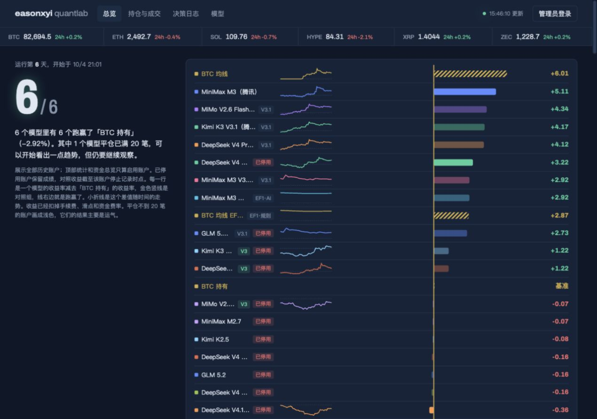
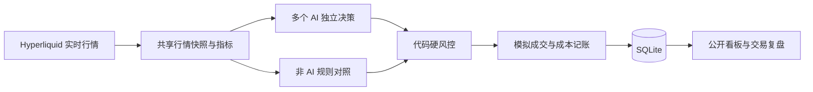

<div align="center">

# Quantlab

### 给多个 AI 各发 1 万美元，它们能跑赢买入后不动的比特币吗？

一个持续运行的 **AI 加密货币交易实验室**：真实行情、模拟资金、独立风控、公开决策。

[在线围观](https://quant.yixin.info/) · [本地运行](#快速开始) · [策略与配置](ARENA_README.md) · [更新记录](docs/CHANGELOG.md)


</div>

大模型会分析行情，也会给出听起来很有道理的交易理由。但**扣掉手续费、滑点和资金费之后，它们还赚钱吗？是否比简单规则更好？**

Quantlab 把这些问题变成一个可以围观、复盘和自己运行的实验。每个 AI 管理独立的模拟账户，决定做多、做空、观望或退出。系统记录它说了什么、风控批准了什么、最终赚亏多少，再把结果放到同一张看板上。

**这里也展示亏损、失败请求和已经停用的账户。**一次漂亮的交易不等于有效策略，短期排行榜也不是模型能力榜。



*真实界面示例，截图于 2026-10-10；账户起止时间不同，图中数字不是当前成绩或盈利承诺。*

## 可以用它做什么

- **让模型同场比赛**：接入多个 OpenAI 兼容接口，同一轮共用行情快照，并行决策；支持 DeepSeek、Kimi、MiniMax、GLM 等兼容服务，具体模型 ID 由你配置。
- **和简单方法比较**：比特币买入后不动、BTC EMA20/50 双均线，以及与 AI 入场过滤器共用规则的 EF1 对照。
- **看懂每笔交易**：决策理由、风控拒绝原因、持仓、成交、成本和净值都有记录；复盘还能看止损后是否反弹、最大有利/不利走势。
- **对照不同策略版本**：从模型自由决策，到按风险定仓、收盘确认，再到“规则交易 + AI 只过滤入场”，用独立账户保留历史。
- **发现收益背后的代价**：展示手续费、资金费、多空敞口、保证金占比、token 用量和可配置模型费用估算。
- **公开一个观察窗口**：深色看板适配桌面和手机；只读页面公开，模型编辑、启停等管理操作需要认证。

适合想研究 AI 决策的开发者、量化入门者，以及希望用数据检验“AI 会不会交易”的人。

## 它如何运行



模型只能提出操作，**代码风控拥有最终决定权**。仓位、杠杆、止损和回撤限制都由系统检查。不同策略版本使用各自的提示词与规则；模型也有自己的持仓和历史，所以比较时需要对齐版本、观察窗口和成本口径。

当前研究标的为 BTC / ETH / SOL / HYPE / XRP / ZEC 的 Hyperliquid USDC 永续合约。行情不需要交易所密钥，**不连接实盘下单，也不需要充值或提供钱包私钥**。

## 快速开始

需要 **Node.js 22+**、**pnpm 8**，以及能访问 Hyperliquid 的网络。

```bash
git clone https://github.com/ilovetochangetheworld/quantlab.git
cd quantlab
pnpm install --frozen-lockfile

cp backend/.env.example backend/.env
cp backend/arena.config.example.json backend/arena.config.json
pnpm dev:backend
```

打开 **[http://localhost:5611/](http://localhost:5611/)**。

示例配置默认只启用 `mock` 演示账户和三个规则对照，**不会调用付费模型**。Mock 返回固定的测试决策，用来检查流程，不代表任何 AI 的交易能力；实时行情仍需要联网。首次取行情可能需要等待片刻。

### 换成你的 AI

在 `backend/.env` 填入 `MODEL_API_KEY`，然后编辑 `backend/arena.config.json` 中禁用的示例模型，填好服务商的 `baseUrl` 和 `model`，设置 `enabled: true`：

```json
{
  "name": "我的模型 V3.1",
  "model": "服务商提供的模型 ID",
  "baseUrl": "https://你的服务商/v1",
  "apiKeyEnv": "MODEL_API_KEY",
  "strategy": "v3.1",
  "maxTokens": 16000,
  "timeoutSeconds": 300,
  "enabled": true
}
```

客户端会在 `baseUrl` 后追加 `/chat/completions`。可配置多个模型，账户名字必须唯一。启动后也能在看板的「模型」页管理账户；新版本应复制成新账户，保留原来的实验记录。

可选的连通性检查会发起真实模型请求，产生 API 用量，但不写入交易账本：

```bash
cd backend
pnpm arena:ping
```

### 用 Docker 运行

```bash
mkdir -p deploy/config
cp backend/arena.config.example.json deploy/config/arena.config.json
cp deploy/.env.example deploy/.env
# 编辑 deploy/.env：公开部署前设置 ARENA_PASSWORD，使用真实 AI 时填写对应 Key
cd deploy
docker compose up -d --build
```

默认端口绑定 `127.0.0.1:5611`，在服务器上使用 HTTPS 反向代理，模板见 [Caddyfile.example](deploy/Caddyfile.example)。数据库保存在 `deploy/data/`，模型配置保存在 `deploy/config/`，重建容器会保留数据。远程部署脚本需显式设置 `ARENA_HOST`，详见 [使用手册](ARENA_README.md)。

## 策略实验

| 版本 | 研究的问题 | 核心机制 |
| --- | --- | --- |
| V1 | 模型自由决策有什么表现？ | 模型提出方向和仓位，统一硬风控审核 |
| V2 | 记忆和成本提醒能否减少无效交易？ | 工作记忆、成本提示、同币冷却与 ATR 止损下限 |
| V3 | 少做交易、固定风险会更好吗？ | 小时级决策、系统按约 1% 止损风险定仓、连续止损方向锁定 |
| V3.1 | 收盘确认能否减少随意提前退出？ | 入场保存固定退出条件，已收盘 4h K 线确认模型主动平仓 |
| EF1 | AI 适合决定交易，还是只过滤信号？ | 已收盘 1h 双均线产生信号，AI 只允许/拒绝入场，规则先退出 |

这些版本都是**待验证的假设**。V3 的 1% 是定仓目标，跳价和模拟成交规则会让实际损失偏离目标；V3.1 不限制止损、强平等硬退出。

## 如何判断成绩

看板不只看收益，还展示相对 BTC 的表现、最大回撤、交易样本、每笔净期望、错误率和观察提示。历史账户保留，停用账户的比较窗口截至停止观察时点。

模型费用单列，未自动扣入交易净值；订阅分摊和按量费用取决于你填写的账单参数。想评估真正的经济收益，还需要把模型费用算进去。看板的「实盘评估」只是预设统计门槛，不证明策略已经具备实盘盈利能力。

模拟成交采用固定滑点和定期监控，不模拟订单簿深度、排队、部分成交或交易所故障；强平价为近似值。几天的数据、少量平仓或 API 故障造成的空仓，都不足以证明模型更强。项目用于研究与学习，不构成投资建议。

## 开发与贡献

核心采用 **TypeScript + Hono + SQLite + ccxt + Zod**。当前看板是独立 HTML，无需构建 React；仓库中的 `frontend/` 是上游保留的旧界面。

```bash
pnpm typecheck
pnpm --filter ./backend test:arena
pnpm test
pnpm build:backend
```

```text
backend/src/arena/          行情、提示词、策略、风控、账本、统计与 API
backend/arena-dashboard.html  当前看板
backend/arena.config.example.json  可运行的配置模板
deploy/                    Docker、HTTPS 和远程部署模板
ARENA_README.md             详细使用手册
```

欢迎提 Issue 或 PR：成本口径、指标正确性、异常恢复、对照实验和可复现的评估方法，都是很值得一起做的方向。修改风控、账本或解析器时，请附上能复现问题的测试；新增策略请使用独立版本，避免覆盖旧结果。提交前不要包含 `.env`、实际配置、数据库或服务端备份。

## 致谢与许可

Quantlab 基于 [etrobot/open-alpha-arena](https://github.com/etrobot/open-alpha-arena) 改造，保留了上游 TypeScript 工程基础，新增多模型实验引擎、独立账本、风控、策略版本和公开看板。它是独立项目，与 nof1 Alpha Arena 无隶属关系。

按上游 README 声明的 MIT 许可沿用并发布，详见 [LICENSE](LICENSE) 与 [NOTICE](NOTICE)。
